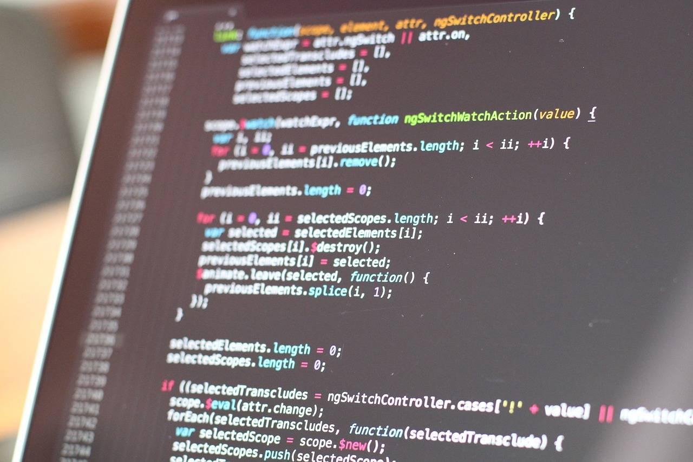

# Improved Particle Filter for Drone's Three-Dimensional Trajectory Prediction Method (Matlab Code Implementation)

Improved Particle Filter for Predicting Three-Dimensional Trajectories of Drones (Matlab Code Implementation)

## Images

<!-- PAYMENT_BLOCK -->

## Get this dataset

- Payment link (Stripe): [Buy now](https://buy.stripe.com/3cs8yP7sY87d0vu9AB)
- Payment QR code: 

<!-- /PAYMENT_BLOCK -->
